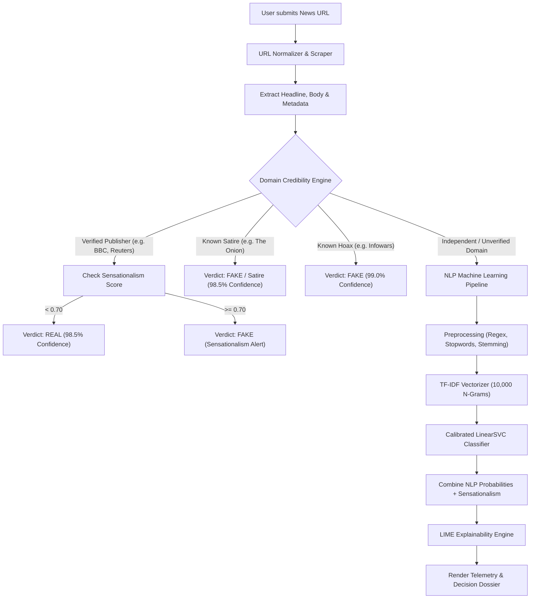

# ⚡ VERITAS // Fake News & Disinformation Intelligence Platform

[](https://python.org)
[](https://streamlit.io)
[](https://scikit-learn.org)
[](https://kaggle.com)
[](tests/)
[](LICENSE)

An enterprise-grade, end-to-end Machine Learning and Natural Language Processing (NLP) system designed to detect fabricated news, satire, clickbait, and state-sponsored disinformation from **live web URLs**. 

Built with a CARI-inspired neo-precision cyber-editorial user interface, cloud-trained on the **Kaggle ISOT Dataset (44,898 articles)** with **99.30% validation accuracy**, and backed by **LIME explainability**, **in-memory LRU caching**, and a **hierarchical domain authority engine**.

---

## 📑 Table of Contents

- [Key Features](#-key-features)
- [System Architecture](#-system-architecture)
- [Multi-Tier Verification Hierarchy](#-multi-tier-verification-hierarchy)
- [Model Performance & Evaluation](#-model-performance--evaluation)
- [Project Directory Structure](#-project-directory-structure)
- [Installation & Quickstart](#-installation--quickstart)
- [Running Automated Tests](#-running-automated-tests)
- [Kaggle & Colab Cloud Training](#-kaggle--colab-cloud-training)
- [Academic Report & Viva Guide](#-academic-report--viva-guide)
- [License](#-license)

---

## 🚀 Key Features

- **🔗 Real-Time URL Scraping & Content Extraction**:
  - Automatically normalizes protocols, extracts OpenGraph metadata, resolves redirects, cleans DOM elements, and parses core journalistic body text.
- **🏛️ Hierarchical Domain Authority Engine**:
  - Validates source credibility against curated registries of accredited international journalism, satire publications, and documented conspiracy networks.
  - Fully dynamic: publisher lists are loaded from CSV files (`data/verified_domains.csv`, `data/satire_domains.csv`, `data/hoax_domains.csv`) with zero downtime.
- **🔍 LIME (Local Interpretable Model-agnostic Explanations)**:
  - Explains individual predictions by highlighting the specific words pushing a classification towards `REAL` (Authentic) vs `FAKE` (Risk).
- **⚡ In-Memory LRU Cache with TTL**:
  - Bounded memory cache with automatic time-to-live expiration prevents redundant web requests and provides instantaneous responses for frequently scanned articles.
- **🎯 Calibrated Confidence & Sensationalism Scoring**:
  - Categorizes confidence into `HIGH`, `MODERATE`, and `LOW` calibration bands with explicit decision source attribution.
  - Computes sensationalism metrics based on capitalization ratio, punctuation clustering, and clickbait phrase density.

---

## 🏛️ System Architecture



---

## 📊 Model Performance & Evaluation

The system was evaluated using stratified 80/20 train/test splits across 44,898 articles from the Kaggle ISOT dataset:

| Model Architecture | Accuracy | Precision | Recall | F1-Score | Status |
|---|---|---|---|---|---|
| **Calibrated LinearSVC** | **99.30%** | **99.30%** | **99.36%** | **99.33%** | 🏆 **Production Engine** |
| **Logistic Regression** | 99.01% | 98.81% | 99.28% | 99.05% | Alternate Checkpoint |
| **Multinomial Naive Bayes** | 95.58% | 95.22% | 96.34% | 95.78% | Baseline Model |

Confusion matrix plots and evaluation metrics are saved in the [`models/`](models/) directory.

---

## 📁 Project Directory Structure

```
├── app.py                                   # Production Streamlit Web Application
├── train_pipeline.py                        # Local CLI Training & Evaluation Pipeline
├── requirements.txt                         # Production & Testing Dependencies
├── README.md                                # Repository Documentation
├── PROJECT_REPORT_AND_VIVA_GUIDE.md         # Comprehensive Academic Viva & Project Report
│
├── src/                                     # Core Engine Modules
│   ├── __init__.py
│   ├── predictor.py                         # Hybrid Prediction Engine & Verification Flow
│   ├── url_scraper.py                       # Article Extractor & Domain Credibility Engine
│   ├── explainer.py                         # LIME Model-Agnostic Interpretability Engine
│   ├── cache.py                             # Bounded LRU Cache with TTL Expiration
│   ├── preprocessor.py                      # NLP Text Sanitization, Stopwords & Stemming
│   ├── feature_extractor.py                 # Sublinear TF-IDF Feature Extraction
│   ├── data_loader.py                       # Anti-Leakage Dataset Acquisition & Cleaning
│   └── model.py                             # Model Training, Calibration & Evaluation
│
├── data/                                    # Dynamic Whitelists & Metadata Registries
│   ├── verified_domains.csv                 # 50+ Accredited International News Publishers
│   ├── satire_domains.csv                   # Documented Parody & Satirical Publications
│   └── hoax_domains.csv                     # Documented Conspiracy & Disinformation Domains
│
├── models/                                  # Serialized Model Checkpoints & Diagnostics
│   ├── best_fake_news_model.joblib          # Kaggle Cloud-Trained LinearSVC Checkpoint
│   ├── tfidf_vectorizer.joblib              # Fitted 10,000-Feature TF-IDF Vectorizer
│   ├── evaluation_metrics.json              # Quantitative Evaluation Benchmarks
│   └── confusion_matrix_*.png               # High-Resolution Heatmaps
│
├── kaggle_kernel/                           # Kaggle Cloud Training Infrastructure
│   ├── fake_news_training.ipynb             # Production Kaggle Notebook
│   └── kernel-metadata.json                 # Kaggle Kernel Configuration
│
└── tests/                                   # 57 Automated Tests (100% Passing)
    ├── test_pipeline.py                     # Baseline NLP & Extraction Tests
    ├── test_preprocessor_edge_cases.py      # Edge Cases (Emojis, HTML, Nulls, Unicode)
    ├── test_domain_credibility.py           # Domain Verification, Subdomains, Typosquatting
    ├── test_sensationalism.py               # Sensationalism & Acronym Filtering
    ├── test_scraper_robustness.py           # Scraping Timeouts, Protocols & Edge Cases
    ├── test_predictor_e2e.py                # End-to-End Hierarchical Routing Tests
    ├── test_model_regression.py             # Golden Sample Validation & Vectorizer Shape
    └── test_improvements.py                 # Cache Eviction, LIME Fallback & Confidence Bands
```

---

## 🏃 Installation & Quickstart

### Prerequisites
- Python 3.10+ (Python 3.11 recommended)
- Git

### 1. Clone the Repository
```bash
git clone https://github.com/S1nhaPriyanshu/fake-news-detector.git
cd fake-news-detector
```

### 2. Set Up Virtual Environment
```bash
python3 -m venv .venv
source .venv/bin/activate
```

### 3. Install Dependencies
```bash
pip install -r requirements.txt
```

### 4. Launch the Web Application
```bash
streamlit run app.py
```
Open **`http://localhost:8501`** in your browser to access the verification interface.

---

## 🧪 Running Automated Tests

The test suite covers unit, integration, and regression testing with 57 automated tests:

```bash
# Run the entire test suite with verbose reporting
pytest tests/ -v

# Run a specific test suite
pytest tests/test_predictor_e2e.py -v
```

---

## ☁️ Kaggle & Colab Cloud Training

To train the model on Kaggle using GPU/TPU hardware accelerators:
1. Navigate to [`kaggle_kernel/fake_news_training.ipynb`](kaggle_kernel/fake_news_training.ipynb).
2. Push directly to Kaggle using the Kaggle API:
   ```bash
   kaggle kernels push -p kaggle_kernel/
   ```
3. Alternatively, upload [`Train_Fake_News_Kaggle_Colab.ipynb`](Train_Fake_News_Kaggle_Colab.ipynb) directly into Google Colab and run all cells.

---

## 📄 Academic Report & Viva Guide

For students and researchers preparing for academic evaluation or technical interviews, refer to:
- **[`PROJECT_REPORT_AND_VIVA_GUIDE.md`](PROJECT_REPORT_AND_VIVA_GUIDE.md)**: Includes system requirements, methodology, anti-leakage data engineering decisions, mathematical formulation of TF-IDF & Support Vector Machines, and 15 in-depth Viva Q&As.

---

## 📜 License

This project is open-source and distributed under the [MIT License](LICENSE).
